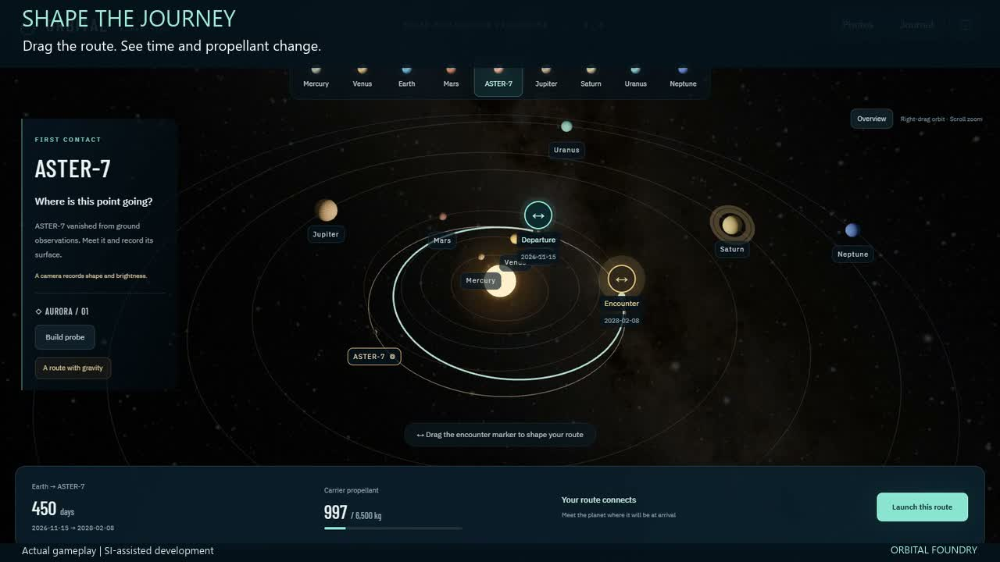
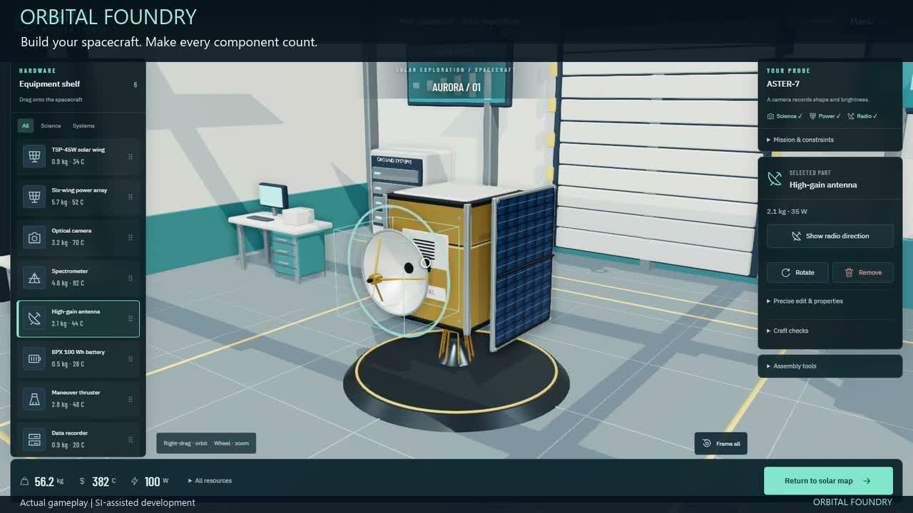
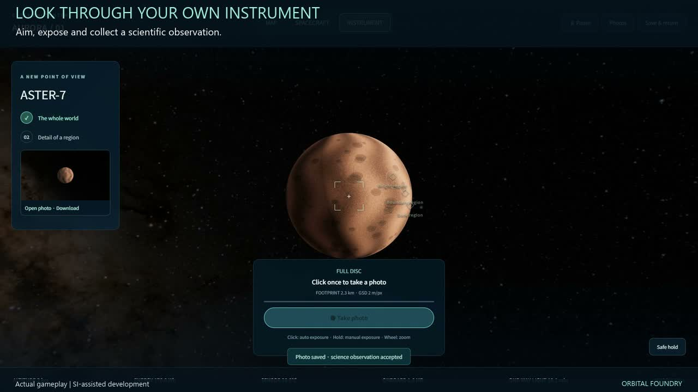

<div align="center">

# NASA · ORBITAL FOUNDRY

### 우주선을 만들고, 항로를 그리고, 나만의 발견을 지구로.

NASA 자료를 바탕으로 만든 **웹 브라우저 3D 우주 임무 설계 게임**

[**게임 플레이**](https://orbital-foundry-mission-lab.gjtjwns06.chatgpt.site/) · [**29초 데모**](https://orbital-foundry-mission-lab.gjtjwns06.chatgpt.site/demo/) · [English](README.md)



</div>

## 관측이 끊긴 소행성, 우리가 만든 탐사선

가상의 소행성 **ASTER-7**의 관측이 끊겼습니다. 탐사선을 보내 그 모습을 확인하고 관측 자료를 지구로 돌려보내야 합니다.

장비를 기체에 직접 붙이고 태양계 지도에서 항로를 조절하며, 자신이 고른 관측기의 시선으로 우주를 바라봅니다. 질량·예산·전력·통신·추진제 제약은 실제 선택의 결과로 이어집니다.

| 조립 | 관측 |
| :--- | :--- |
|  |  |

## 플레이 흐름

1. **탐사 시작** — 짧은 이야기로 임무의 목적을 확인합니다.
2. **탐사선 조립** — 장비를 기체에 끌어 붙입니다. 우클릭으로 회전하고 휠로 확대합니다.
3. **항로 설계** — 출발·조우 손잡이를 움직여 비행 시간과 추진제를 비교합니다. 가능한 경우 행성 스윙바이도 선택합니다.
4. **탐사선 운용** — 자세 이상에 대응하고 항로·기체·관측기 시점을 바꿔 봅니다.
5. **관측과 발견** — 전체 모습과 세부를 촬영하거나 두 파장의 관측을 비교합니다. 사진을 저장하고 유효 자료를 송신해 지구 수신까지 확인합니다.

사진 저장, 유효한 과학 관측, 지구 수신은 서로 다른 단계입니다.

## 실행

Node.js **22.12 이상**, npm, WebGL을 지원하는 데스크톱 브라우저가 필요합니다.

```bash
git clone https://github.com/gjtjwns06-ui/NASA-Orbital-Foundry.git
cd NASA-Orbital-Foundry
npm ci
npm run dev
```

표시된 주소를 엽니다. PowerShell 실행 정책 오류가 나면 `npm` 대신 `npm.cmd`를 사용하세요.

```bash
npm run build
npm run preview
npm run test:solar
```

API 키나 계정 없이 실행합니다. 설계·항해·사진은 브라우저에 저장됩니다. 전체·브라우저 테스트 방법은 [영문 README](README.md#run-locally)에 있습니다.

## 과학적 근거와 범위

JPL 행성 근사 요소, 별도 지구–화성 실험실의 Horizons 벡터, CubeSat 101, NASA 소형 우주선 기술 자료와 출처를 표시한 우주 이미지를 활용했습니다. GMAT는 개발 중 일부 중심중력 사례를 비교하는 데 실행했으며 브라우저에 내장하지 않았습니다.

교육용 궤도·스윙바이·관측 모델입니다. 가상 사건과 표면 반응을 포함하며 실제 임무 인증, 실제 물질의 분광 식별, 검증된 학습 효과를 주장하지 않습니다.

- [NASA 및 전체 자료 출처](public/demo/resources.tsv)
- [GMAT 검증 범위](docs/gmat-validation.md)
- [스윙바이 모델](research/solar-assist-model.md)
- [관측·운용 모델](research/expedition-operations-design.md)
- [에셋 출처](docs/asset-provenance.md)

## 제작

TypeScript · Three.js/WebGL · Blender/Python · Vite · Vitest · Playwright

ChatGPT/Codex가 기획, 코드, 절차적 에셋 스크립트, 테스트와 문구 작성을 보조했습니다. 데모는 실제 실행 화면이며 플레이 중 생성형 AI API를 사용하지 않습니다.

NASA라는 이름은 챌린지와 참고 자료의 맥락을 나타냅니다. **NASA 공식·인증·후원 프로젝트가 아닌 독립 교육용 프로젝트입니다.** 외부 자료의 권리는 각 출처에 따르며, 프로젝트 코드의 오픈소스 라이선스는 아직 지정하지 않았습니다.
