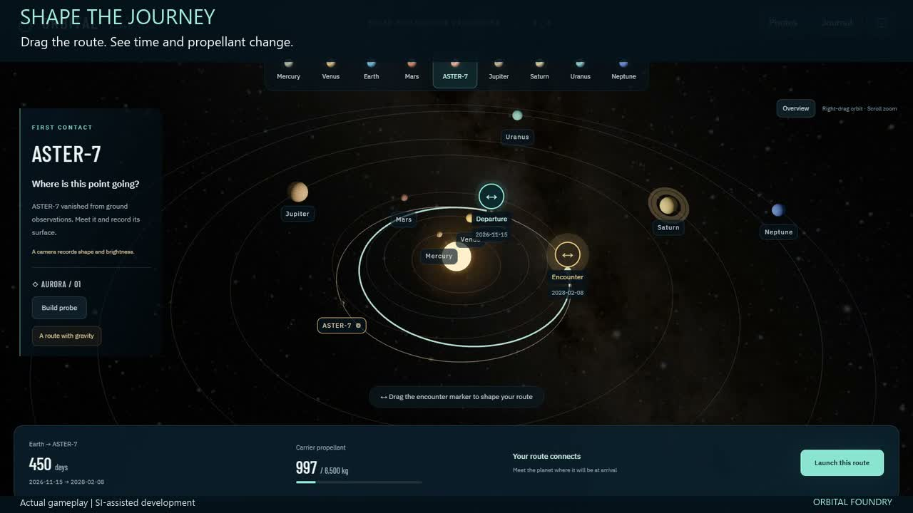
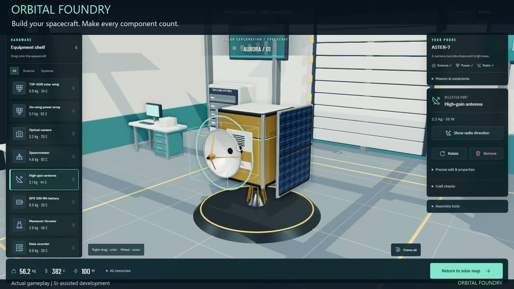
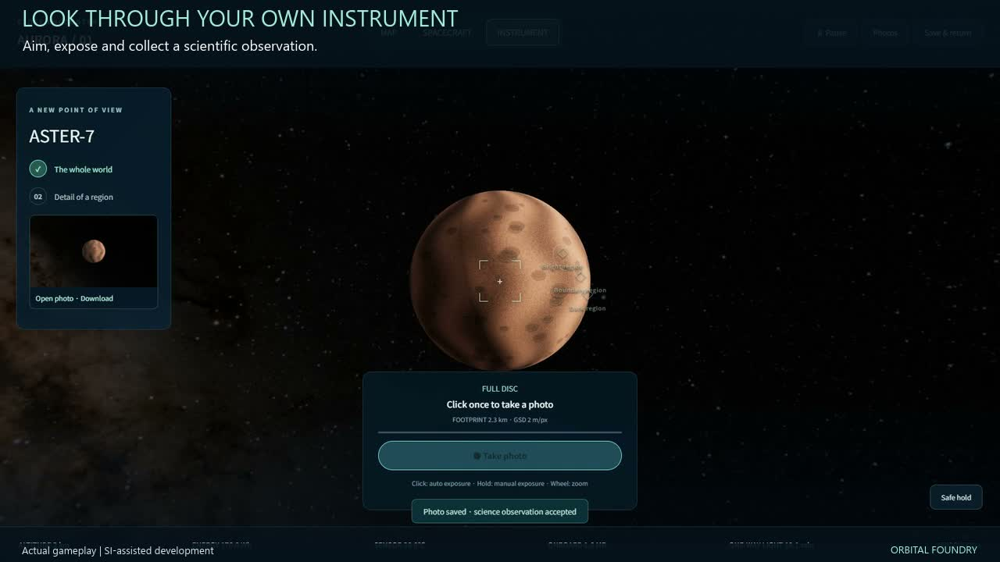

<div align="center">

# NASA · ORBITAL FOUNDRY

### Build a spacecraft. Shape its journey. Discover a world.

A **3D mission-design game** for the browser.<br>
Created for the NASA Space Apps Challenge

[](https://orbital-foundry-mission-lab.gjtjwns06.chatgpt.site/)
[](https://orbital-foundry-mission-lab.gjtjwns06.chatgpt.site/demo/)
[](README.ko.md)

[](https://orbital-foundry-mission-lab.gjtjwns06.chatgpt.site/)

**Build → Navigate → Operate → Observe → Transmit → Discover**

</div>

## Your mission starts with a missing observation

ASTER-7 has disappeared from ground observations. In this fictional scenario, your team sends a probe to meet it, investigate its surface and return evidence to Earth.

You build that probe yourself. The equipment you choose becomes your view of space, and the route you shape determines what your mission can achieve.

> [**Open the game**](https://orbital-foundry-mission-lab.gjtjwns06.chatgpt.site/) in a desktop Chrome or Edge browser and choose **Begin exploration**. No account or API key required.

## From the workbench to the Solar System

| Build something that can fly | Bring discoveries home |
| :--- | :--- |
|  |  |
| Drag equipment onto a 3D spacecraft. Balance mass, budget, power and pointing constraints. | Aim through your mounted instrument. Keep photographs and return valid science to Earth. |

- **Assemble a probe** — mount instruments, antennas and power hardware directly on the spacecraft.
- **Explore the Solar System** — depart Earth toward seven other planets or the fictional ASTER-7.
- **Shape the journey** — drag departure and encounter handles; watch travel time and propellant change.
- **Compare gravity assists** — weigh a planetary flyby's fuel requirements against extra time and encounter constraints.
- **Make operational decisions** — recover from a pointing fault and work within the observation window.
- **Look through what you built** — switch between the route map, spacecraft and mounted instrument views.
- **Collect and keep discoveries** — photograph global and detailed views, compare two spectral bands, download images and transmit observations.

The game distinguishes **a saved picture**, **a valid scientific observation**, and **data received on Earth**. They are different achievements.

## Watch the mission

[**Watch the 29-second demonstration →**](https://orbital-foundry-mission-lab.gjtjwns06.chatgpt.site/demo/)

Actual gameplay: equipment installation → trajectory editing → an onboard decision → observation → the photo album → Earth receipt → the next destination.

[Download MP4](public/demo/orbital-foundry-demo.mp4) · [Submission description](public/demo/project-text.txt) · [Complete resource list](public/demo/resources.tsv)

## Run locally

**Requirements:** Node.js 22.12+ and npm; a desktop browser with WebGL support.

```bash
git clone https://github.com/gjtjwns06-ui/NASA-Orbital-Foundry.git
cd NASA-Orbital-Foundry
npm ci
npm run dev
```

Open the URL printed by Vite. On Windows PowerShell, use `npm.cmd` if execution policy blocks `npm.ps1`.

```bash
npm run build      # Type-check and create dist/
npm run preview    # Serve the production build locally
npm run test:solar # Focused campaign, orbit, instrument and photo checks
npm test           # Full suite, including slower historical/physics checks
```

**Checked for this export:** 62 focused model tests and the production build passed. The full historical suite has a known stale byte-identity check; see [release checks and limits](docs/RELEASE_CHECKS.md). CI runs the focused suite and build.

Designs, voyage progress and photos stay in browser-local storage. No runtime generative AI API or paid service is required.

<details>
<summary><strong>Browser interaction checks</strong></summary>

Start the development server in one terminal, then run:

```bash
npx playwright install chromium
npx playwright test tests/browser/photo-capture.spec.ts tests/browser/voyage-flow.spec.ts
```

Default URL: `http://127.0.0.1:5173`. Override with `PLAYWRIGHT_BASE_URL`. Use `PLAYWRIGHT_BROWSER=edge` for installed Edge, or `PLAYWRIGHT_EXECUTABLE_PATH` for a specific executable. Historical recording utilities may retain original local paths.

</details>

## Science you can inspect

| Source | Role |
| :--- | :--- |
| [JPL planetary elements](https://ssd.jpl.nasa.gov/planets/approx_pos.html) | Approximate Solar System positions. |
| [JPL Horizons](https://ssd-api.jpl.nasa.gov/doc/horizons.html) | Bundled vectors for the separate Earth–Mars transfer laboratory. |
| [NASA GMAT](https://github.com/nasa/GMAT) | Development-time comparisons for selected central-gravity cases; not embedded in the browser. |
| [CubeSat 101](https://www.nasa.gov/wp-content/uploads/2017/03/nasa_csli_cubesat_101_508.pdf) and [Small Spacecraft Technology](https://www.nasa.gov/smallsat-institute/sst-soa/) | Mission workflow, subsystem research and hardware references. |
| [NASA gravity-assist guidance](https://science.nasa.gov/learn/basics-of-space-flight/primer/) | Planet-relative and Sun-relative velocity changes. |
| [Deep Star Maps](https://svs.gsfc.nasa.gov/4851/) and credited NASA Earth/Mars maps | Celestial and planetary visual resources. |

**Verification has a scope.** The bundled GMAT comparison covers eight selected Earth/Mars point-mass cases and 6,968 state samples. It does not validate every campaign route or certify a real mission. The campaign uses educational two-body and single-assist approximations with a separate local encounter model. Display scales and encounter playback are adapted for play.

ASTER-7, incidents, carrier parameters and synthetic surface responses are authored content. Two-band measurements do not identify real chemicals. Automated checks do not establish classroom learning gains or human enjoyment.

[GMAT comparison](docs/gmat-validation.md) · [Assist model](research/solar-assist-model.md) · [Observation model](research/expedition-operations-design.md) · [Hardware model](docs/hardware-model-v2.md)

## Under the hood

| Layer | Technology |
| :--- | :--- |
| Application & simulation | TypeScript, browser workers |
| 3D rendering | Three.js / WebGL |
| Interface | HTML, CSS, Lucide |
| Original asset workflows | Blender / Python and procedural Three.js geometry |
| Build & checks | Vite, Vitest, Playwright |
| Persistence | Browser-local storage and IndexedDB |

```text
src/       Application, rendering, mission and instrument models
public/    Runtime assets, credited data and demonstration
tests/     Model tests, historical fixtures and browser scenarios
research/  Model rationale and scientific simplifications
tools/     Asset generation and verification utilities
docs/      Technical documentation, provenance and selected QA records
```

This repository packages the public game release. Raw recording takes, generated browser screenshots, local hosting configuration and transient deployment receipts are excluded. Historical notes may reference earlier builds or local QA captures not included here.

## Credits & transparency

NASA/JPL resources and third-party libraries retain their respective credits and usage terms. See [asset provenance](docs/asset-provenance.md), [all resources](public/demo/resources.tsv) and [third-party notices](THIRD_PARTY_NOTICES.md). No assets were extracted from commercial games. An open-source license for the original project code has not yet been designated.

**SI-assisted development:** ChatGPT/Codex assisted planning, code, procedural asset scripts, testing, debugging and text. The demonstration records actual gameplay, not generated video. No generative AI API is called during play.

**Independent project:** “NASA” identifies the challenge context and referenced resources. This is not an official NASA product, endorsed submission or NASA-certified mission simulator.
