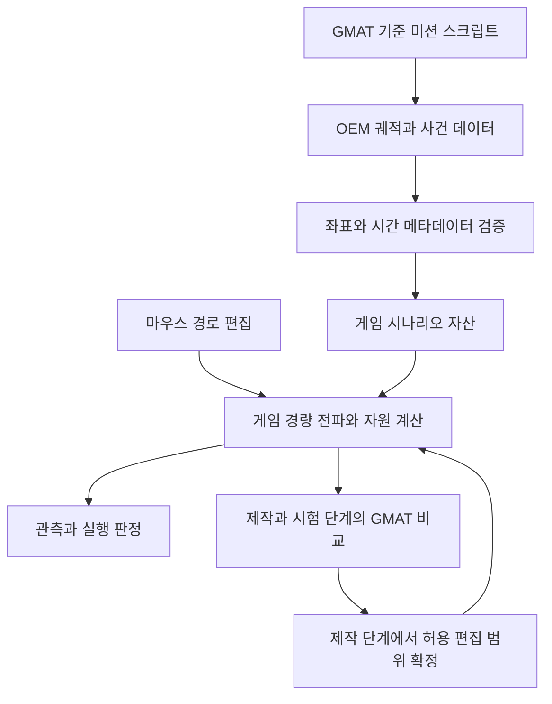

# 우주 임무 설계 게임 기능명세서

문서 버전 1.1 · 작성일 2026년 11월 14일 · 상태 개발 검토용 · 웹 브라우저 우선

플레이어가 과학 임무를 받고, 3D 우주선에 장비를 직접 배치하고, 마우스로 궤도와 기동을 설계한 뒤, 관측 데이터를 지구로 전달하는 우주 임무 설계 게임이다. **장비의 위치와 방향, 비행 경로, 운영 일정이 실제 성과를 바꾸는 것**을 제품의 중심으로 삼는다.

기능 번호는 구현·검증 항목을 연결하기 위한 식별자다. P0는 첫 완성판의 필수 범위, P1은 핵심 완성 후 확장, P2는 장기 확장을 뜻한다. 아래 수용 기준은 앞으로 검증해야 할 개발 기준이며, 구현 또는 검증이 완료되었다는 의미가 아니다.

# 1 제품 방향과 전제

## 확정된 사용자 요구

- NASA Space Apps Challenge의 Space Mission Design Game에 대응한다.
- 예산·질량·전력·통신 등 제한 안에서 과학 임무를 설계하고 수행한다.
- 장비를 3D 기체로 끌어다 놓고, 위치와 방향을 직접 정한다.
- 경로와 기동을 마우스로 만들고 변경한다.
- 스윙바이와 실제 우주 환경을 활용해 탐사한다.
- Solar Smash에서 느껴지는 큰 행성 화면과 직접 조작 직후의 시각적 반응을 참고한다.
- GMAT를 실제 궤도 설계와 검증에 활용하는 방안을 포함한다.
- OpenAI API 및 생성형 AI 기능은 이번 범위에서 제외한다.
- 우선 배포 대상은 설치 없이 접속하는 웹 브라우저다.

## 구현을 위한 제안 전제

| 항목 | 기준안 | 상태 |
| --- | --- | --- |
| 대상 | 우주공학 지식이 없는 학생·일반 참가자 | 기획 제안 |
| 우선 환경 | 데스크톱 웹 브라우저, 마우스와 키보드 | 웹 브라우저 우선은 사용자 확정 |
| 실행 방식 | HTTPS 주소로 접속, 필요한 미션 자산을 로드한 뒤 브라우저에서 계산 | 웹 우선 기준안 |
| 플레이 인원 | 혼자 완주 가능, 한 화면과 하나의 설계를 공유하는 1~4명 토론형 플레이 | 기획 제안 |
| 기본 경험 | 첫 학습 5분 내외, 일반 임무 한 판 10~15분 | 사용성 검증 목표 |
| 그래픽 구현 | TypeScript와 Three.js의 WebGL 2 렌더링, 물리 계산은 Web Worker로 분리 | 웹에 맞춘 기술 제안이며 엔진 확정 아님 |
| 계산 | 재현 가능한 물리·자원 계산과 규칙 기반 설명 | 필수 설계 원칙 |

개발 인원·제출 기한·기준 PC 사양은 아직 정해지지 않았다. 개발 일정은 날짜 대신 완료 조건이 있는 단계로 정의한다. P0 지원은 데스크톱 Chrome·Edge의 검증한 안정 버전으로 정하고 테스트 버전을 기록한다. Firefox·Safari 호환 확대는 P1, 모바일 터치 조작은 P2로 둔다. 첫 접속과 미션 자산 다운로드에는 네트워크가 필요하다. 미션 로드가 끝난 뒤의 계산은 브라우저 안에서 수행하며, 브라우저를 닫은 뒤에도 오프라인으로 새로 시작하는 캐시 기능은 P1이다.

P0 협업은 하나의 마우스와 계획을 공유하며 과학·전력·통신·항법 관점을 협의하는 방식이다. 별도 계정·독립 커서·개인 점수·네트워크 동기화는 요구하지 않는다.

## 제품의 핵심 재미

1. **만드는 재미:** 기체를 돌려보고 장비를 옮겨, 자신의 설계가 눈에 보이는 결과물로 남는다.
2. **발견하는 재미:** 가려진 패널을 옮기면 발전량이 회복되고, 스윙바이 접근점을 조절하면 출구 궤적이 바뀐다.
3. **판단하는 재미:** 관측·충전·송신·기동이 요구하는 시간과 자세가 충돌할 때 우선순위를 정한다.
4. **개선하는 재미:** 같은 상황을 다시 실행하면서 부품 하나나 기동 하나를 바꾼 효과를 비교한다.

핵심 질문은 “가장 비싼 우주선은 무엇인가?”가 아니라 **“이번 임무에서 어떤 설계와 경로가 충분한 과학 성과를 돌려주는가?”**다. 목표의 해상도·범위·기한과 교신 일정이 달라지면 좋은 설계도 달라져야 한다.

# 2 전체 게임 흐름

임무의 과학 질문을 먼저 정하고 설계·검증·운영으로 이어지는 구조를 적용한다. 조립과 경로 설계는 반복해서 오갈 수 있다. 발사·우주선·지상국·데이터 사용까지 연결하는 NASA 임무 설계 관점을 따른다. [S01](https://www.nasa.gov/wp-content/uploads/2025/04/250323-design-and-develop-science-mission.pdf?emrc=a454cf)

| 단계 | 플레이어의 주요 행동 | 즉시 보이는 결과 |
| --- | --- | --- |
| 임무 이해 | 목표 지역·천체와 요구 데이터를 확인 | 목표 표식과 완료 조건 |
| 조립 | 부품 드래그, 이동, 회전, 수납·전개 확인 | 기체 모양, 질량, 비용, 시야와 발전 예측 |
| 경로 설계 | 고도·궤도면·기동 화살표·접근점 드래그 | 이전·새 궤적, 관측 기회, 교신창, 연료 여유 |
| 운영 계획 | 타임라인에서 관측·송신·자세 구간 배치 | 배터리·저장 공간·수신 성과의 시간 변화 |
| 시험 | 시간 커서를 이동하며 취약 구간 확인 | 원인이 표시된 경고와 기체 상태 |
| 실행 | 시간 가속, 중요 시점에서 계획 조정 | 설계와 명령에 따른 실제 시뮬레이션 결과 |
| 결과 | 미션 요구와 수신 데이터를 대조 | 완성된 관측 결과, 실패 원인, 비교 재실행 |

발사 후 기체의 부품 배치는 고정한다. 임무 중에는 설치한 구동부의 허용 범위 안에서 자세·전개·관측·통신·기동을 조절한다. 결과 화면에서 재설계를 선택하면 발사 전 사본으로 돌아간다.

# 3 첫 완성판과 확장 범위

## P0 필수 범위

- 3D 우주선 조립 작업대와 큰 천체 중심의 임무 화면.
- 유효한 장착 표면 안에서 부품 위치·회전을 직접 조절하는 조립.
- 패널의 자기 가림, 관측기 시야, 안테나 지향과 가림의 실제 판정.
- 궤도 손잡이, 기동 노드와 방향 화살표, 스윙바이 접근점 편집.
- 지구관측 학습 임무와 화성 스윙바이 대표 임무 각 1개.
- 질량·크레딧 예산·발전과 배터리·데이터 저장·통신·추진제 계산.
- 관측·충전·송신 일정 편집, 사전 시험, 가속 실행, 결과 분석과 재도전.
- GMAT 기준 궤적과 비교 검증 자료, NASA 데이터 출처 표시.
- 저장·불러오기·설계 A와 B 비교·3분 시연 프리셋.

스윙바이와 마우스 장비 배치는 첫 완성판의 합격 조건이다. 이를 제외한 지구관측 시제품은 중간 개발 단계로 취급한다.

## 우선순위 표

| 범위 | P0 | P1 | P2 |
| --- | --- | --- | --- |
| 조립 | 기본 버스 2종과 호환 장비 약 16종, 기체당 최대 20개 부품 | 짐벌·추가 내부 베이·태양 센서 배치 | 구조 설계·배선·완전한 열 및 진동 해석 |
| 경로 | 지구궤도와 화성 스윙바이의 제한된 편집 영역 | 검증된 소행성 플라이바이 경로 | 무제한 천체계와 임의 출발 조건 최적화 |
| 사건 | 식 구간·통신 가림·지구궤도 잔해 근접 시나리오 | 태양 입자 사건·먼지 위험·부품 복구 | 장기 열화와 다중 고장 캠페인 |
| 탐사 기법 | 화학추진의 짧은 보정 기동과 중력도움 | 저에너지 달 전이·에어로브레이킹 | 전력과 추력 시간을 연결한 이온 추진 |
| 협업 | 한 기기에서 1~4명이 역할을 나누어 협의 | 역할 카드와 팀 목표 비교 | 실시간 온라인 공동 편집 |
| 배포 | HTTPS 웹 배포, 데스크톱 Chrome·Edge, 로드한 미션의 브라우저 내 실행 | Firefox·Safari 검증, 재접속용 오프라인 캐시 | 모바일 조작·클라우드 계산·계정·온라인 순위 |

부품 수는 콘텐츠 제작 목표다. 출처·호환성·조작 품질을 충족한 카탈로그를 먼저 완성하고 변형을 늘린다. 빈 항목을 실제 사양처럼 임의로 채워 수량을 맞추지 않는다.

# 4 임무와 난이도

## 공통 임무 정보

모든 임무는 과학 질문, 대상, 필요한 장비 기능, 데이터 종류·품질·관측 시점, 수신 기한, 예산·질량 한도, 출발 조건, 지상국 일정, 허용 기동, 종료 계획을 가진다. 필수 목표와 추가 목표를 분리한다.

임무·시간 제한·크레딧·점수는 게임 설정값이다. 실제 NASA 임무의 명칭·날짜·예산과 혼동하지 않게 구분한다. 실제 기관의 임무를 재현했다고 표시하려면 초기조건과 결과를 별도로 검증해야 한다.

## 지구관측 임무 M01

**과학 질문:** 정해진 지역의 지표 상태를 필요한 공간 해상도와 관측 횟수로 확인할 수 있는가?

- 초반 안내는 부품 하나 배치 → 시야 확인 → 궤도 고도 조절 → 관측·송신 배치 순서로 진행한다.
- 같은 환경에서 ‘좁은 지역의 정밀 관측’과 ‘넓은 지역의 반복 관측’ 중 목표를 고른다. 목적에 따라 장비와 경로의 가치가 달라진다.
- 허용 궤도 범위와 출발 시간대는 발사 패키지가 제공한다. 실제 관측 대상 도달 여부는 지표 경로와 센서 시야로 판정한다.
- 최소 목표는 요구 품질을 충족한 지정 관측 자료의 지상 수신이다. 유효한 추가 지역·반복 관측은 추가 성과다.
- 첫 안내 실행은 예측 가능한 식 구간과 교신창을 제공한다. 별도 변형에서는 추적 가능한 잔해 근접 통과에 대응한다.
- 기본 한 판은 게임 시간 8~12분을 목표로 하며, 실제 궤도 시간은 압축한다.

단계 A에서 실제 목표 좌표·요구 해상도·관측 횟수·수신 기한·예산·질량 한도·출발 상태를 수치로 채운 MissionDefinition을 고정한다. 각 목표 유형에 성공 가능한 설계와 계획을 최소 두 개 확보해 기준 콘텐츠로 사용한다.

관측 결과는 대상 지역의 지도와 수신된 구획으로 보여준다. NASA 참고 영상을 사용하면 ‘NASA 참고 영상’으로 표시하고, 플레이어가 새로 실제 촬영한 위성 영상으로 설명하지 않는다.

## 화성 스윙바이 임무 M02

**과학 질문:** 주어진 추진제와 기한 안에서 화성에 접근하여 요구 관측을 수행하고, 중력도움 뒤 정해진 태양중심 궤도 조건을 달성할 수 있는가?

- 과학 목표는 화성 근접 관측 데이터 수신이며, 항법 목표는 스윙바이 뒤 지정된 출구 방향·에너지 범위 달성이다.
- 출발 기준 상태와 허용 발사창은 제작 단계에서 GMAT로 확정한다. 플레이어는 그 주변의 검증된 범위 안에서 출발·보정 기동·접근점을 조절한다.
- 화성 앞의 접근 평면에 손잡이를 표시한다. 접근점을 옮기면 그 지점에 도달하기 위한 앞 구간의 기동과 스윙바이 이후 궤적까지 함께 계산한다.
- 행성 기준 접근·이탈 속도와 태양 기준 속도·방향 변화를 구분해 보여준다.
- 출구 평가는 시나리오에 고정한 화성 중심 평가반경을 외향 통과하는 사건으로 정의한다. 그 사건 시각과 태양중심 관성좌표의 위치·속도·비궤도에너지로 판정한다. 평가반경과 허용 범위는 기준 해 생성 때 고정한다.
- 최근접 고도·대기 경계·관측 거리·추진제·기한을 동시에 판정한다. 화성 관측을 위해 지나치게 가까운 접근을 선택하면 안전 조건을 만족하지 못할 수 있다.
- 기체는 심우주 통신이 가능한 호환 버스를 사용한다. 지구관측용 소형 무전기를 그대로 달아 행성간 통신을 할 수 있게 만들지 않는다.
- 게임 시간 10~15분을 목표로 하며, 오랜 비행은 중요한 계획·관측 구간 중심으로 압축한다.

**기술 검증 산출물:** 실제 천체력, 기준 epoch, 위치·속도, 접근 조건, 기동, 출구 궤적, 데이터 수신 구간을 가진 성공 해 1개와 대안 해 3개 이상. 아직 이 경로를 실행 검증한 상태는 아니다. 이 산출물을 확보하기 전에는 대표 미션의 제작 완료를 선언하지 않는다.

소행성까지의 후속 항해는 P1 별도 미션 M03으로 둔다. GMAT의 화성 접근 예제가 특정 소행성까지의 도달을 보증한다고 해석하지 않는다.

## 난이도와 준비 상태

| 단계 | 제공하는 도움 | 플레이어가 책임질 결정 |
| --- | --- | --- |
| 안내 | 기본 버스·가능 표면·손잡이·한 문장 설명 | 부품 배치와 단순 관측·송신 |
| 표준 | 예측 타임라인·물리 제약·경고 원인 | 장비·경로·운영의 조합 |
| 도전 | 제한된 여유와 사전에 명시한 불확실성 | 안전 여유와 추가 과학 성과의 균형 |

준비 상태는 목표 정의, 필수 기능 확보, 경로 가능성, 운영 시험의 네 항목으로 표시한다. CML의 반복 설계 관점을 참고하지만 이를 NASA 인증이나 임무 성공확률로 표시하지 않는다. [S03](https://dataverse.jpl.nasa.gov/api/access/datafile/50237?format=original&gbrecs=true)

# 5 화면 구성과 마우스 조작

## 하나의 작업 공간

큰 3D 장면을 중심으로 ‘조립 보기·경로 보기·운영 보기’를 오간다. 상단은 임무와 필수 목표, 좌측은 부품 또는 경로 도구, 우측은 선택 대상과 자원 상태, 하단은 예측·운영 타임라인이다. 패널을 접어 장면을 넓힐 수 있다.

조립 보기에서는 실제 기체 크기와 축을 확인한다. 경로 보기에서는 행성과 우주선의 위치, 미래 천체 위치, 궤도, 관측 영역, 교신 가시선을 본다. 시점 전환 후에도 선택 대상과 편집 중인 계획은 보존한다.

## 기본 입력

| 입력 | 행동 | 충돌 방지 규칙 |
| --- | --- | --- |
| 좌클릭 | 부품·천체·기동 노드 선택 | 선택과 실행을 구분하고 한 번 클릭으로 기동을 확정하지 않음 |
| 부품을 장면으로 드래그 | 가져오기·배치 | 유효 표면·가림·충돌을 미리 표시 |
| 선택 부품 드래그 | 표면 내 이동 | 이동 도구가 활성화된 동안만 부품 이동 |
| 회전 고리 드래그 | 부품 방향 변경 | 선택 축과 회전량 표시 |
| 궤도 손잡이 드래그 | 고도·궤도면 변경 | 허용 발사 조건과 계산 상태 표시 |
| 기동 화살표 드래그 | 진행·반경·궤도면 방향의 속도 변화량 조절 | 좌표 방향과 단위를 표시 |
| 스윙바이 접근점 드래그 | 접근 목표와 출구 궤적 편집 | 접근 평면을 따로 보여 깊이 조작의 혼란 방지 |
| 타임라인 구간 드래그 | 관측·송신·자세 시작과 길이 조절 | 불가능한 겹침과 명령 도달 시점 표시 |
| 우클릭 드래그·휠·가운데 버튼 | 카메라 회전·확대·이동 | 부품 배치와 별도 입력으로 처리 |
| 더블클릭 | 선택 대상에 카메라 초점 | 카메라 이동 취소·즉시 전환 제공 |

Esc는 확정 전 조작 취소, Ctrl+Z와 Ctrl+Y는 실행 취소와 다시 실행, Space는 실행의 일시정지·재개에 사용한다. 실행 취소는 조립·계획과 아직 발송하지 않은 명령 편집에 적용한다. 비행 중 이미 발송한 명령이나 수행한 기동·관측·전송을 취소해 과거 자원을 복구하지 않으며, 과거 시점 변경은 별도 재도전 사본에서 수행한다. 드래그의 대체 수단으로 선택 후 이동·회전 키와 수치 입력을 제공한다. 키 배치는 사용자 설정에서 바꿀 수 있게 한다.

# 6 임무와 조립 기능

## 임무 기능

| ID | 기능과 동작 | 수용 기준 |
| --- | --- | --- |
| MIS01 | 브리핑에 과학 질문·필수 자료·품질·수신 기한·자원 한도를 표시 | 설명 화면과 결과 판정이 같은 임무 정의 데이터를 사용 |
| MIS02 | 목표 지역·천체를 장면에서 선택하고 관련 장비 기능을 확인 | 목표를 바꾸면 필요한 기능과 성과 판정도 함께 변경 |
| MIS03 | 같은 환경의 서로 다른 과학 목표와 동일 조건 재도전을 제공 | 임무 목표·환경 시드·기준 시각을 저장하고 재현 |
| MIS04 | 발사 패키지의 적재 질량·수납 공간·출발 상태·비용을 확인 | 기체의 젖은 질량과 선택 경로가 해당 패키지에 적합한지 판정 |

## 장비 배치 기능

| ID | 기능과 동작 | 수용 기준 |
| --- | --- | --- |
| ASM01 | 부품 팔레트에서 기체의 유효 표면으로 드래그해 부착 | 고정 소켓 선택에만 한정하지 않고 허용 표면 내 위치를 직접 정함 |
| ASM02 | 부품 위치·방향·기체 면을 변경하고 실제 크기의 반투명 모형 제공 | 미리보기와 확정 배치의 크기·위치가 같고 충돌 배치는 확정되지 않음 |
| ASM03 | 관측기 시야·패널 법선·안테나 지향과 가림 표시 | 같은 시각과 자세에서 위치·방향 변경이 관련 물리 판정에 반영 |
| ASM04 | 내부 부품은 내부 베이에 배치하고 외피 숨기기·단면 보기 제공 | 배터리·저장장치가 외벽에 장식처럼 붙지 않으며 체적 제약을 적용 |
| ASM05 | 수납·전개 상태와 패널·안테나 운동 공간 확인 | 다른 부품과의 간섭 또는 발사 수납 치수 초과를 식별 |
| ASM06 | 호환 전력·데이터 연결을 자동 구성하고 불일치를 설명 | 맞지 않는 버스·장비 조합을 이유 없이 성공 상태로 처리하지 않음 |
| ASM07 | 질량·비용·저장 용량·모드별 소비전력·질량중심을 갱신 | 추가·삭제·이동·취소·불러오기 후 모형과 계산 상태가 일치 |
| ASM08 | 복제·삭제·실행 취소·다시 실행과 발사 전 설계 스냅샷 제공 | 최소 최근 30개 확정 조작을 복원하고 해당 예측도 다시 계산 |

## 배치가 결과를 바꾸는 규칙

- **관측기:** 기체나 다른 부품이 시야를 막으면 해당 방향의 관측이 제한된다. P0는 시야 원뿔의 대표 광선과 대상 방향을 사용한 가림 판정으로 단순화한다.
- **태양전지:** 태양 방향에 대한 패널의 방향과 다른 부품에 의한 가림을 반영한다. 조립 중 ‘태양 방향 미리보기’를 움직여 배치를 시험한다.
- **안테나:** 지향 범위와 지구·지상국 방향, 기체 가림을 반영한다. P0의 고정 안테나는 기체 자세 변경이 필요하다. 짐벌 부품은 P1에서 비용·질량·소비전력과 함께 추가한다.
- **추진계:** P0 주추진기는 허용된 추력축의 전용 장착 영역에 배치한다. 현재 질량중심과 추력선의 오프셋이 버스 프로파일의 허용 범위를 넘으면 경고하고 해당 설계의 발사를 차단한다. 오프셋 허용값은 P0의 단순화된 설계 조건으로 표시한다. 임의의 옆면 엔진을 아무 토크 비용 없이 주추진기로 사용할 수 없게 한다.
- **질량중심:** 총질량의 가중 평균으로 표시하고 발사 인터페이스 허용 범위 확인에 사용한다. 중심에서 벗어났다는 이유만으로 임의의 ‘우주 불안정 점수’를 부과하지 않는다. 완전한 관성·추력 오프셋·6자유도 동역학은 확장 범위다.

질량·CG·관성모멘트·치수·운영 시험이 실제 통합 정보라는 CubeSat 101의 원칙을 참고한다. 문서는 2017년판이므로 특정 치수·발사비·규제 수치를 2026년의 공통 요구사항으로 복사하지 않는다. [S07](https://www3.nasa.gov/sites/default/files/atoms/files/nasa_csli_cubesat_101_508.pdf)

# 7 경로 편집과 스윙바이 기능

## 편집 기능

| ID | 기능과 동작 | 수용 기준 |
| --- | --- | --- |
| NAV01 | 근지점·원지점 손잡이와 궤도면 고리로 초기 궤도 조절 | 초기 위치·속도 또는 궤도 요소를 바꾸고 중력 모델로 다시 전파 |
| NAV02 | 장면의 천체와 미래 위치를 선택해 조우 목표 지정 | 현재 위치와 미래 조우 위치를 구분하고 조우 시각을 표시 |
| NAV03 | 궤적 위에 기동 노드를 놓고 시각·방향·크기 편집 | 이전 기동까지 반영한 상태에서 이후 전 구간과 연료를 다시 계산 |
| NAV04 | 접근 평면의 손잡이로 화성 스윙바이 조절 | 앞 구간의 보정 기동과 최근접 고도·출구 궤적을 함께 해결 |
| NAV05 | 이전 경로와 새 후보 경로를 겹쳐 비교 | 관측·교신·식·Δv·도착 시점 중 실제로 바뀐 결과를 갱신 |
| NAV06 | 계산 중·추정·실행 가능·실행 불가를 구분 | 미수렴·충돌·추진제 부족·오래된 결과를 실행 가능으로 확정하지 않음 |
| NAV07 | 지구 지표 경로 지도와 3D 궤도를 연동 | 센서의 실제 관측 범위와 대상 지역·지상국을 같은 시각에 표시 |
| NAV08 | 허용 발사창·장비·추진 성능 변경을 경로 조건에 반영 | 질량 변경 후 발사 적합성·가능 Δv·연소시간을 재판정 |

## 경로를 손으로 만드는 방식

플레이어가 선과 손잡이를 끌면 내부적으로 바뀌는 값은 출발 상태, 기동 시각과 Δv, 조우 조건이다. 요청한 모양은 미리보기로 표현하고, 물리 계산을 마친 후보를 확정 경로로 보여준다.

- 원하는 천체에 조우 표식을 놓고, 타임라인에서 만날 시각을 조정한다.
- 경로 위 노드의 세 축 화살표를 당겨 방향과 속도 변화량을 정한다.
- 행성 근처에서는 접근 평면을 화면에 펼쳐 최근접 통과 위치를 조절한다.
- 새 경로가 유효하면 연료·관측·통신의 차이를 함께 보여준다.
- 해가 없으면 부족한 조건을 표시하고 마지막 유효 계획으로 돌아갈 수 있게 한다. 사용자 입력을 숨겨진 최적해로 자동 대체하지 않는다.

처음부터 모든 출발일·천체·접근점을 자유롭게 허용하지 않는다. 검증된 편집 영역의 경계를 손잡이에 표시한다. 계산이 어려운 경우에도 ‘검증 후보에 스냅’된다는 사실을 화면에서 분명히 알린다.

## 스윙바이의 과학 규칙

행성의 공전 운동과 중력에 의해 태양 기준 속도·방향이 바뀐다. P0 대표 스윙바이의 근접 구간은 무추력으로 정의하고, 보정 기동은 그 앞뒤의 허용 노드에서 수행한다. 행성 기준의 멀리 떨어진 입출구 속력과 태양 기준 속도 변화를 혼동하지 않는다. 최근접 고도만 낮추면 항상 좋은 결과가 나오는 규칙을 사용하지 않는다. 접근 속도·방향·천체 위치·안전 경계가 함께 작용한다. [S10](https://science.nasa.gov/learn/basics-of-space-flight/primer/)

시각적 보상은 손잡이 조절 뒤 출구 궤적이 목표 영역으로 이어지는 장면이다. ‘중력도움으로 절약한 추진량’은 동일 도착 조건을 만족하는 검증된 비교 경로가 있을 때만 수치로 표시한다. 비교 경로가 없으면 속도·방향·에너지 변화만 표시한다.

# 8 운영 계획과 임무 실행 기능

| ID | 기능과 동작 | 수용 기준 |
| --- | --- | --- |
| OPS01 | 타임라인에 관측·송신·충전 자세·기동 구간을 배치 | 시작·길이·순서를 드래그하면 자원 예측과 충돌 구간을 갱신 |
| OPS02 | 기체 자세와 모드별 장비 활성 상태를 계획 | 고정 관측기·안테나·패널의 방향 조건을 같은 기체 자세에서 판정 |
| OPS03 | 발사 전 한 임무의 정상·취약 구간을 시험 재생 | 시각 이동으로 배터리·저장·가시선·관측을 확인하고 설계로 복귀 |
| OPS04 | 시간 가속과 중요 사건 앞 일시정지 제공 | 가속 배율이 결과를 바꾸지 않으며 필수 판정 시각을 건너뛰지 않음 |
| OPS05 | 실행 중 명령 예약과 계획 수정, 지상 대기·전파 중·수신 완료 구분 | 발송과 도착 시각의 가시선·지향·수신기 상태 및 광행시간을 반영하고 단절 중 새 명령은 지상 큐에 보관 |
| OPS06 | 전력 부족·저장 포화·일정 충돌에서 원인과 회복 행동 표시 | 회복 가능한 상태를 즉시 기체 파괴로 처리하지 않고 확보 성과를 보존 |
| OPS07 | 부품 전개·관측·송신·엔진 사용을 기체 애니메이션과 연결 | 실제 실행 상태와 연출이 일치하며 편집 전용 배치 기능은 잠김 |

실행의 일시정지는 플레이어가 계획을 살펴보는 편의 기능이다. 심우주 우주선에 즉시 명령이 전달되는 능력을 부여하지 않는다. 새 명령은 지상 송신 큐에서 발송 기회를 기다리고, 실제 발송 뒤 빛의 이동 시간을 거쳐 수신 여부를 판정한다. 이미 전파 중인 명령이 우주 공간에서 기다리는 방식으로 구현하지 않는다. 미리 저장된 명령은 통신 단절 중에도 실행된다.

기체의 자세가 바뀌면 관측기·안테나·패널도 함께 회전한다. 모드마다 모든 장비가 자동으로 최적 방향을 향한다고 가정하지 않는다. 자세 전환 시간과 전력은 버스의 명시된 단순화 모델을 사용한다.

# 9 실제 환경과 사건

사건 데이터에는 발생 조건, 플레이어가 알 수 있는 정보, 대응 가능 시간, 가능한 행동, 자원 변화, 과학 영향, 복구와 종료 조건을 기록한다. 예측 가능한 기하학적 현상과 불확실한 환경 사건을 구분한다.

| 사건 | 범위와 발생 조건 | 플레이어 대응 | 결과와 판정 |
| --- | --- | --- | --- |
| 식 구간 | P0, 천체가 태양을 가리는 실제 기하 | 충전·절전·관측·송신 일정 변경 | 패널 발전 감소와 배터리 사용 |
| 통신 가림 | P0, 천체 차폐·지상국 비가시 | 명령 사전 예약·저장·후속 교신 | 해당 시간의 송신·명령 수신 제한 |
| 잔해 근접 통과 | P0 M01 변형, 사전 정의한 추적 가능 물체와 궤적 | 허용 시각의 회피 기동·관측 후 재평가 | 연료와 일정 변화, 최소 접근 조건 판정 |
| 태양 입자 사건 | P1, 명시된 환경 시나리오와 불확실한 예보 | 운영 축소·안전 모드·중복 장치와 복구 절차 | 장비 오류·운영 중단을 시나리오 규칙으로 계산 |
| 소행성 추가 관측 | P1, 도달 가능성이 확인된 조우 기회 | 본임무 유지 또는 보정 기동과 관측 시간 배정 | 상대 속도·거리·빛·지향 조건으로 관측 가치 계산 |
| 먼지 위험 | P1, 대상 근접 구간의 명시된 위험 모델 | 접근 거리·자세·관측 일정 조정 | 안전성과 과학 성과의 변화 |
| 에어로브레이킹 | P1, 대기가 있는 천체의 포획 후 타원궤도 | 대기 상층 통과 고도와 횟수 조정 | 추진제·열·하중·소요시간, 허용 회랑 판정 |
| 저에너지 전이 | P1, 검증된 지구·달·태양의 경로 | 빠른 경로와 연료 효율 경로 비교 | 연료와 운영 기간·기한의 맞교환 |

지구궤도 잔해는 자연 소행성과 구분한다. 큰 소행성이 매 순간 무작위로 우주선에 돌진하는 연출을 기본 환경으로 사용하지 않는다. 잔해 회피의 학습은 “일찍 기동해 연료를 아낄지, 추가 추적을 기다릴지”에 둔다. 실제 충돌확률 모델이 없는 P0에서는 임의의 확률 퍼센트를 표시하지 않는다. [S11](https://www.nasa.gov/cara/step-3-close-approach-risk-mitigation/)

태양 입자 사건을 선회로 피해 다니는 장면으로 만들지 않는다. 안전 모드는 방사선을 차단하는 방패가 아니다. 에어로브레이킹은 화성 궤도 포획 이후의 반복 대기 통과를 먼저 구현하고, 행성간 접근에서 한 번에 포획하는 에어로캡처와 구분한다. [S12](https://science.nasa.gov/heliophysics/science-questions/how-does-solar-variability-affect-human-society-technological-systems-and-the-habitability-of-planets/) [S13](https://science.nasa.gov/missions/maven/nasas-maven-uses-red-planets-atmosphere-to-change-orbit/)

## 사건과 난이도의 공정성

- 초급은 확정된 예측과 고정된 환경으로 진행한다.
- 표준은 같은 임무의 조건 변형으로 판단을 요구한다.
- 불확실한 예보나 고장은 도전 모드에서 조건과 모델을 공개한 뒤 도입한다.
- 사건 때문에 선택이 생기도록 하고, 대처 불가능한 무작위 즉사를 반복 보상 구조로 사용하지 않는다.
- 재도전은 같은 시드·시각·환경을 기본으로 유지한다. 새 환경으로 바꾸는 선택은 별도로 제공한다.

# 10 자원과 과학 모델

## 데이터의 세 가지 구분

| 구분 | 예 | 표시 원칙 |
| --- | --- | --- |
| 출처 기반 값 | 부품 질량·소비전력·용량, 천체 위치·물성 | 원문 링크·판본·단위·적용 조건 보존 |
| 계산값 | 배터리 변화·가시선·궤적·연료 소비·수신량 | 사용한 모델과 중요한 단순화 표시 |
| 게임 설정값 | 크레딧·과학 가중치·기한·힌트·난이도 | NASA의 실제 가격·성공확률로 표현하지 않음 |

NASA 2026 Small Spacecraft 보고서는 공개 기술 정보를 정리한 자료다. 수록 부품을 NASA가 인증하거나 성능을 보증한다고 표현하지 않는다. 상충하는 값은 원 제조사 자료와 조건을 확인하고, 없는 값은 미확인으로 둔다. [S08](https://www.nasa.gov/smallsat-institute/sst-soa/)

## 계산 규칙

| 항목 | P0 계산 원칙 | 제한과 확인 사항 |
| --- | --- | --- |
| 질량 | 젖은 질량 = 버스의 건조 질량 + 추가 부품 + 실제 남은 추진제 | 버스에 포함된 부품을 중복 합산하지 않음 |
| 예산 | 버스·장비·발사·정의된 운영 비용의 크레딧 합 | 실제 구매가와 구분, 비용 없는 부품을 임의로 최고 성능으로 만들지 않음 |
| 태양발전 | 1 AU 기준 패널 발전 × 거리의 역제곱 × 입사각 계수 × 가림 계수 | 기준 발전량에 이미 포함된 효율을 다시 곱하지 않음 |
| 배터리 | 발전과 소비의 차이를 시간 적분해 Wh로 누적 | 충방전 효율·최대 출력·용량·최소 운영 에너지 적용 |
| 자세 | 기체의 자세·장비 장착 방향·허용 회전과 전환 시간 | P0는 버스별 전환 모델, 완전한 강체 동역학은 제외 |
| 관측 | 대상의 시야 포함·가림·관측 시간·해상도·지향 조건 | 장비 개수나 파일 크기만으로 과학 성과를 결정하지 않음 |
| 저장 | 생성 데이터와 실제 전송 데이터를 누적 관리 | 저장 한도 초과 전 경고, 기본은 새 관측 중단이며 자동 삭제 안 함 |
| 통신 | 가시선·지상국 가시성·안테나 지향·거리·RF 링크 조건 | RF 출력과 배터리 소비전력을 구분 |
| 추진 | 짧은 화학추진 기동은 Δv와 로켓 방정식으로 소비 추진제 계산 | 기동 길이·추력과 순간 기동 가정의 적합성 확인 |
| 궤도 | 초기 위치·속도·중력 모델·실행 기동으로 전파 | 경로 길이를 연료 소비로 환산하지 않음 |

배터리의 에너지는 W가 아니라 Wh로 표시한다. 시간 간격이 초일 때 에너지 변화의 기본 단위 변환은 `전력차 W × 경과초 / 3600`이며, 충전과 방전 효율을 각 방향에 적용한다. 식 구간에서는 해당 가시성 모델에 따라 태양발전을 낮춘다. [S08 전력 장](https://www.nasa.gov/smallsat-institute/sst-soa/power-subsystems/)

기체와 부품의 가림은 실제 조립 형상으로 판정한다. P0는 패널 대표 점·광선, 관측기 시야 광선, 안테나 대표 지향 광선을 사용하는 단순화다. 샘플링 해상도를 고정하고 경계 부근의 판정 오차를 검증한다.

## 통신과 데이터 단위

내부 데이터량은 bit, 전송률은 bit/s로 통일한다. Byte 표시로 바꿀 때 8배 변환을 명시하고 MB·MiB 표기를 혼용하지 않는다. 광속에 따른 전달 시간 `거리 / 광속`은 명령과 데이터 수신에 적용한다. 위성에서 전송을 마친 상태와 지구에서 수신을 마친 상태를 구분한다. 발송·도착 시각의 링크 조건을 확인하고 실패한 명령·자료는 정해진 재시도 정책으로 처리한다.

통신 모델은 RF 출력·안테나 이득·거리의 자유공간 경로손실·수신기 조건·손실·요구 신호 여유를 사용해 지원 가능한 전송 모드를 고른다. C/N₀는 dB-Hz, 전송률 Rb는 bit/s로 사용해 `Eb/N₀[dB] = C/N₀[dB-Hz] - 10 log10(Rb)`를 비교한다. 가시선이나 지향 조건이 충족되지 않으면 해당 링크 전송률은 0이다. 수신기·지상국의 가정값과 변조·코딩별 기준은 시나리오 데이터에 기록한다. 장비의 최대 광고 전송률을 모든 거리에서 그대로 제공하지 않는다. [S08 통신 장](https://www.nasa.gov/smallsat-institute/sst-soa/soa-communications/)

## 추진과 질량의 관계

같은 위치·속도와 실제 수행한 Δv가 같다면 작은 우주선의 중력 궤적은 장비 질량 증가만으로 달라지지 않는다. 질량 변경은 발사 적합성, 가능한 Δv, 추진제 소비, 연소시간에 반영한다.

기동은 실제 수행 순서에 따라 남은 질량으로 계산한다. 추진제 소비를 한 곳에서만 반영하고 음수 연료·연료 없는 기동을 허용하지 않는다. 순간 기동 가정을 벗어나는 긴 연소는 P0 경고 또는 허용 범위 밖으로 처리한다. 이온 추진은 시간에 따른 추력과 전력을 함께 다루는 별도 유한추력 모델이 마련된 뒤 제공한다.

# 11 GMAT 활용과 검증 설계

## 실제 활용 범위

제공된 SourceForge 배포를 기준으로 GMAT R2026a를 검토한다. 개발 착수 시 배포본·천체력·상수·힘 모델·스크립트의 버전과 해시를 고정한다. GMAT는 **기준 경로 설계, 대안 경로 생성, 게임 전파 결과의 비교 검증**에 실제 사용한다. [S02](https://sourceforge.net/projects/gmat/files/GMAT/GMAT-R2026a/)

Mission Viz는 궤적 시각화 구조의 참고 자료다. Earth–Moon 예제처럼 GMAT에서 계산한 Cartesian 궤적을 표시하는 접근을 참고한다. 이 저장소가 장비·예산·과학 성과를 판정하는 완성 게임 엔진을 제공한다고 가정하지 않는다. [S05](https://github.com/nasa/mission-viz) [Earth–Moon 예제](https://nasa.github.io/mission-viz/X3Dom/20160129_Earth_MoonMission_X3D.html)

## P0 연결 방식

1. 제작용 PC에서 GMAT로 M01과 M02의 기준 해와 대안을 계산한다.
2. OEM을 브라우저용 JSON 또는 바이너리로 변환한다. 시각별 위치·속도, 태양·지구·화성의 천체력, 기동·사건 시각, 중심·축·시간계·단위·상수·힘 모델·버전을 함께 내보낸다.
3. 브라우저의 Web Worker는 같은 초기조건과 정의된 힘 모델을 사용하는 경량 전파기로 제한 범위의 편집을 처리한다. 렌더링과 입력을 담당하는 메인 스레드와 요청·결과 메시지를 주고받는다.
4. 편집 변수의 허용 범위와 표본 검증에서 합격한 영역만 제품에 노출한다.
5. 플레이어는 웹 주소만 열며 GMAT를 설치하지 않는다. P0 런타임은 GMAT 실행 파일이나 원격 계산 서버를 호출하지 않는다.

연속 편집의 오차 기준을 만족하지 못하면 **GMAT로 계산한 후보에 손잡이가 스냅되는 방식**으로 전환한다. 이 경우 ‘검증된 경로 후보’임을 명확히 표시하고 실제로 선택 가능한 접근점·기동 대안을 여러 개 제공한다. 서로 다른 궤적 좌표를 섞은 보간선을 새로 검증된 물리 경로라고 판정하지 않는다. 단일 궤적의 시간 샘플 사이 표시 보간과, 서로 다른 해를 섞는 행위를 구분한다.

## 브라우저 실행 구조

GMAT 콘솔 실행과 OEM 출력은 제작 도구에서 사용한다. 제작용 Windows 환경의 `GmatConsole.exe --run` 명령을 플레이어 브라우저에서 직접 실행하는 구조로 설계하지 않는다. 공식 콘솔 옵션과 EphemerisFile 문서로 사전 계산 파이프라인을 확인한다. [콘솔 옵션](https://raw.githubusercontent.com/nasa/GMAT/main/src/console/driver.cpp) [궤적 출력](https://raw.githubusercontent.com/nasa/GMAT/main/doc/help/src/Resource_EphemerisFile.xml)

브라우저의 경로 계산 작업에는 계획 버전·요청 번호를 부여한다. 최신 요청만 반영하며 취소·실패·시간 초과 시 마지막 유효 계획을 유지한다. 경량 미리보기의 반응 목표와 별개로 긴 계산의 기본 시간 초과 목표는 15초로 두고 기술 검증에서 조정한다. 연속 편집의 검증 목표를 만족하지 못하면 동일한 브라우저 화면에서 검증된 후보에 스냅되는 방식으로 대체한다. Web Worker의 분리 실행을 활용하되 P0는 SharedArrayBuffer나 다중 스레드 WASM을 필수로 요구하지 않는다. [S17 Web Workers](https://developer.mozilla.org/en-US/docs/Web/API/Web_Workers_API/Using_web_workers)

## 좌표와 시간

- 물리 상태는 배정밀도이며 길이·속도·질량·시간 단위를 명시한다.
- 브라우저 물리 상태는 JavaScript number와 Float64Array로 유지한다. 렌더링용 Float32Array로 변환한 좌표를 물리 상태에 다시 넣지 않으며, 기준 epoch를 접속한 현재 날짜로 바꾸지 않는다.
- GMAT의 km·km/s와 게임의 m·m/s 변환은 한 변환 계층에서 처리한다.
- 각 경로에 중심천체, 좌표계 축, epoch, 시간계, 천체력과 힘 모델을 기록한다.
- 내부 연속 경과초와 사용자에게 표시하는 UTC 날짜·시각을 구분한다. GMAT의 A1/UTC ModJulian 값을 Unix 시간으로 읽지 않는다.
- 행성 중심 상태와 태양 중심 상태를 전환할 때 해당 시각의 행성 위치·속도를 함께 적용한다.
- P0의 경로 비교는 EME2000/MJ2000Eq 계열의 공통 관성축으로 변환해 수행한다. 지구 지표 지도에는 같은 시각의 지구고정 좌표 변환을 별도로 적용한다.
- 렌더링 원점 이동, 천체 크기 확대, 아이콘 크기 변경은 물리 계산에 영향을 주지 않는다.

## GMAT 기능 요구

| ID | 요구 | 수용 기준 |
| --- | --- | --- |
| GMT01 | 기준·대안 경로를 실제 GMAT로 생성 | 재실행 가능한 스크립트·버전·로그·OEM·메타데이터 보유 |
| GMT02 | 경량 전파와 GMAT 결과 비교 | 같은 초기조건·힘 모델로 정한 오차 범위 충족 |
| GMT03 | 입력 변경 시 전체 경로와 기동 재평가 | 앞 구간·행성 조우·출구 구간의 연결이 끊어지지 않음 |
| GMT04 | 브라우저에서 검증 후보 방식으로 대체 가능 | GMAT 설치·실행 파일·원격 계산 호출 없이 동일 후보를 재현하고 현재 설계의 질량·연료·전력·통신을 다시 계산 |
| GMT05 | 검증되지 않은 상태를 구분 | 추정 선·미수렴 결과·범위 밖 입력에 검증 완료 표시가 붙지 않음 |

## 최초 검증 목표

아래 값은 NASA의 인증 기준이 아니라 개발팀이 검토할 초기 목표다. 임무 판정을 뒤집는 오차가 있으면 수치 목표를 충족해도 불합격이다.

| 비교 항목 | 초기 목표 |
| --- | --- |
| 지구궤도 전파 | 동일한 단순화 힘 모델로 24시간 비교 시 위치 차이 최대 1 km |
| 스윙바이 | 허용 영역의 표본 최소 20개에서 화성 중심 최근접 거리 차이 1% 이하, 동일 평가반경의 외향 통과 상태를 공통 태양중심 관성축으로 비교해 출구 속력 0.5% 이하·방향 0.5도 이하 |
| 미션 판정 | GMAT 기준과 목표 도달·충돌·안전 경계 통과 여부가 동일 |
| 자원 일치 | 같은 기동·질량에서 예측과 실행의 추진제 및 Δv 차이가 설정 허용오차 안에 있음 |
| 경계 시험 | 편집 영역 모서리·최소 고도·연료 한계·시간 한계를 별도 검증 |

최근접 고도는 최근접 중심거리에서 시나리오의 행성 기준 반지름을 뺀 값으로 별도 기록한다. 안전·목표 경계에는 비교 오차를 고려한 여유를 두고, 판정이 애매한 후보는 추가 계산 또는 검증 후보 선택으로 처리한다. 표본 비교만으로 임의의 연속 입력 전체가 인증되었다고 표시하지 않는다.

P0의 성공 해와 대안을 확보하지 못하면 소행성 경로를 임의로 연결하지 않는다. 먼저 대표 화성 스윙바이 범위를 축소해 검증하고, 연속 편집이 어려우면 명시된 후보 스냅 방식으로 완성한다.

# 12 과학 성과와 결과 분석

## 성과 판정

과학 성과의 기본 단위는 요구 품질을 만족하고 기한 안에 지상에서 수신한 고유 관측 자료다. 각 자료는 대상 구역·관측 시각·종류·품질·bit 단위 데이터량·수신 진행률을 가진다. 같은 자료의 중복 전송은 중복 보상이 없다. P0에서는 필요한 자료 단위의 수신이 완료되어야 해당 관측 실적으로 인정한다. 부분 수신은 진행 상황으로 표시하며, 재구성 가능한 부분 자료를 따로 정의한 임무에서만 그 단위로 인정한다.

- **완전 성공:** 필수 과학 목표와 해당 미션의 필수 항법·운영 조건 달성.
- **부분 성공:** 일부 유효 과학 자료를 전달했지만 필수 요구 일부 미달.
- **임무 미달:** 필요한 자료를 전달하지 못했거나 필수 안전·도달 조건 미충족.

기체 생존과 과학 성공은 따로 표시한다. 기체를 보존한 것만으로 과학 성공을 부여하지 않고, 미션이 종료되어도 이미 수신된 유효 자료는 보존한다.

점수는 비교를 위한 게임 규칙으로, 우선 필수 목표 달성 상태를 보여준 뒤 100점 구성의 세부 지표를 제공한다. 초기 배점안은 유효 과학 성과 60, 목표 기한·항법 등 미션별 조건 25, 자원 효율과 안전 여유 15다. 필수 목표를 달성하지 않은 실행이 남은 예산만으로 완전 성공 실행보다 높은 등급을 받지 않게 한다.

과학 점수의 기본식은 `60 × Σ(요구별 가중치 × 달성 비율) / Σ(요구별 가중치)`다. 달성 비율은 유효하고 중복되지 않은 수신 자료 수를 요구 수로 나누어 0~1로 제한한다. 미션 조건 25점과 자원·여유 15점의 세부 산식·기준값은 임무의 ScoreDefinition에 고정하고 시작 전에 열람할 수 있게 한다. 결과를 본 뒤 가중치를 바꾸지 않는다.

## 결과 기능

| ID | 기능과 동작 | 수용 기준 |
| --- | --- | --- |
| RES01 | 필수 요구별 달성 여부와 수신 과학 자료 표시 | 임무 정의와 실제 실행 로그에서 계산한 결과가 일치 |
| RES02 | 실패·손실 원인을 시간과 행동에 연결 | 경고 문구가 실제 원인 이벤트·자원 상태를 참조 |
| RES03 | 설계 A를 복제해 B를 만들고 같은 조건으로 비교 | 부품 배치·경로·운영의 변경점과 결과 차이를 함께 표시 |
| RES04 | 한 가지를 바꾸는 재실행과 구간 재생 제공 | 재실행 계산 없이 성과 증가량을 임의로 제시하지 않음 |
| RES05 | 관련 NASA 자료·유사 임무와 단순화 설명 제공 | 출처와 게임 계산·참고 영상을 구분 |

설명은 API 없이 규칙과 계산 로그로 생성한다. 예를 들어 ‘관측기 전력 초과’, ‘패널 가림’, ‘수신 기한 후 전송’, ‘카메라 시야 차폐’의 원인 코드에 관측 시각과 해당 상태를 연결한다. 다음 시도에서는 원인 하나를 수정하도록 안내하고 자동으로 정답 설계를 완성해주지 않는다.

# 13 그래픽과 연출

## 시각 방향

Solar Smash의 큰 천체 화면과 직접 조작에 대한 즉각적 반응을 시각적 참고로 삼는다. 장비를 붙이고 경로를 조절한 결과가 과학 오버레이와 탐사 장면에 이어지게 한다. 해당 게임의 홍보 표현을 본 게임의 물리 검증 근거로 사용하지 않는다. [S09](https://paradyme.games/)

| 시각 요소 | 요구 |
| --- | --- |
| 행성 | 선명한 표면, 낮·밤 경계, 지구의 대기 가장자리와 구름 |
| 기체 | 패널·금속 재질, 실제 배치 형상, 수납·전개와 방향 변화 |
| 궤도 | 현재 경로·이전 경로·계산 중 후보의 선 모양 구분 |
| 과학 오버레이 | 관측 시야·패널 가림·교신 가시선·접근 평면·안전 경계 |
| 임무 보상 | 수신한 영역이 채워지는 지도, 관측 카드와 비교 결과 |
| 카메라 | 기체에서 천체·경로로 부드럽게 전환, 이동 건너뛰기 |
| 효과 | 엔진·전개·관측·송신의 실제 상태와 연동 |

통신선·방사선 영역은 이해를 위한 시각화임을 표시한다. 우주에서 실제로 보이는 광선이나 폭풍 구름으로 설명하지 않는다. 우주선 아이콘과 천체 표시 크기를 확대하면 ‘표시 크기 조정’ 상태를 제공한다. 확대 표시한 행성 반지름으로 충돌·가림을 계산하지 않는다.

## 그래픽 기능과 접근성

| ID | 요구 | 수용 기준 |
| --- | --- | --- |
| VIS01 | 천체 중심의 넓은 화면과 조립·경로 시점 연동 | 편집 대상이 바뀌어도 카메라·선택 상태를 예측 가능하게 유지 |
| VIS02 | 과학 오버레이를 목적별로 표시·숨김 | 장면을 가리지 않고 경고 원인을 해당 부품·구간에서 확인 |
| VIS03 | 선·아이콘·문구로 계산과 상태를 구분 | 색만으로 가능·불가능·이전·현재를 구별하지 않음 |
| VIS04 | 흔들림·플래시·과도한 빛 번짐 감소와 UI 배율 제공 | 모든 필수 정보가 효과 감소 상태에서도 전달 |
| VIS05 | 드래그의 키보드·수치 입력 대체 제공 | 필수 설계 조작을 대체 입력으로 완료 가능 |

게임의 기본 텍스트는 한국어로 작성하고 핵심 UI·임무·결과의 영어 전환을 제공한다. 처음 등장하는 용어에는 쉬운 설명을 붙이고, 심화 수식과 원문 자료는 선택해서 볼 수 있게 한다.

시각 검증용 표준 캡처는 기본 조립, 패널 자기 가림, 지구궤도 편집, 스윙바이 접근점 편집, 결과 비교의 다섯 장면으로 정한다. 1280×720 및 큰 UI 설정에서도 핵심 손잡이·경고·목표 표식이 패널에 가려지지 않고, 상태별 선 모양과 가림 원인을 구분할 수 있어야 한다.

# 14 데이터 구조와 출처 관리

## 주요 데이터

| 데이터 | 필수 내용 |
| --- | --- |
| MissionDefinition | 과학 질문·대상·요구 자료와 품질·기한·제약·발사 패키지·지상국·종료 조건·환경 시드 |
| ComponentDefinition | 부품 ID·기능·질량·크기·소비전력 모드·능력·크레딧·호환·장착 면·가림 형상·출처 |
| ComponentInstance | 부품 ID·기체 기준 위치와 회전·전개 상태·연결·모드 |
| SpacecraftDesign | 버스·장비 사본·건조/젖은 질량·남은 추진제·질량중심·예산·설계 버전 |
| TrajectoryPlan | 기준 epoch·중심천체·좌표/시간계·초기 상태·기동·조우 목표·계산 상태·검증 범위 |
| OperationsPlan | 자세·관측·송신·절전·전개 명령과 실행 시각·기한·충돌 정보 |
| ObservationRecord | 대상 셀·시각·종류·품질·데이터량·송신과 수신 진행·고유 식별자 |
| SimulationRun | 설계와 계획 버전·현재 시각·동적 상태·남은 자원·지상 대기/전파 중/탑재 명령·전송 중 자료·환경 시드·모델 버전·사건·성과 |
| ScoreDefinition | 요구별 가중치·달성 비율 계산·미션 조건 및 자원 점수 산식·기준값·버전 |
| SourceRecord | 원문 URL·문서명·판본·쪽/절·원 단위·적용 조건·추출일·실측/광고/추정 구분 |

P0 카탈로그는 버스·관측기·패널·배터리·안테나·무전기·자세제어·추진계·저장장치의 범주를 다룬다. 실제 값과 단위를 검토하고 호환 프로파일을 붙인 뒤 플레이에 노출한다. 태양전지 셀의 성능을 완성 패널의 성능으로, RF 송신 출력을 DC 소비전력으로 잘못 가져오지 않는다.

## 저장과 재현 기능

| ID | 요구 | 수용 기준 |
| --- | --- | --- |
| DAT01 | 데이터의 원문·판본·단위·조건을 보존 | 플레이에 쓰는 출처 기반 수치마다 SourceRecord로 추적 가능 |
| DAT02 | IndexedDB에 설계·계획과 일시정지한 실행 저장·재개 제공 | 브라우저를 다시 열어 기체·계획·현재 시각·동적 상태·자원·명령 큐·전송 진행·환경을 복원하고 저장 실패를 알림 |
| DAT03 | 설계·계획·체크포인트를 JSON 파일로 다운로드하고 파일 선택으로 가져오기 | 임의 디스크 경로 접근 없이 동작하고 모르는 버전·누락 필드·비정상 수치를 이유와 함께 처리 |
| DAT04 | 같은 조건 재실행과 과거 결과 보존 | 저장한 실행은 해당 버전으로 재현하거나 호환 불가를 명시 |
| DAT05 | 필요한 자산 로드 뒤 선택한 미션을 브라우저에서 실행 | 원격 계산 API·계정 없이 실행하며 플레이 중 네트워크가 끊겨도 로드한 미션과 출처 요약을 사용 가능 |

큰 원문 PDF를 플레이할 때마다 내려받지 않는다. 필요한 수치와 짧은 출처 정보를 패키지에 포함하고, 원문 열기는 선택 기능으로 둔다.

자동 저장은 확정된 설계 변경과 주요 실행 사건 뒤 일관된 체크포인트에서 IndexedDB 트랜잭션으로 수행한다. 실행 중 수동 저장은 일시정지 후 상태를 확정해 처리한다. 저장 직후부터 계속한 실행과 불러와 재개한 실행의 최종 결과가 허용오차 안에서 같아야 한다. 브라우저 저장은 사이트별이며, 저장 공간 부족·사용자 삭제·비공개 모드의 제한이 있을 수 있으므로 영구 보존으로 약속하지 않는다. 실패 시 현재 세션을 유지하고 JSON 다운로드 대안을 제공한다. [S17 IndexedDB](https://developer.mozilla.org/en-US/docs/Web/API/IndexedDB_API) [저장 한도](https://developer.mozilla.org/en-US/docs/Web/API/Storage_API/Storage_quotas_and_eviction_criteria)

# 15 예외 처리와 상태 관리

| 상황 | 처리 |
| --- | --- |
| 유효하지 않은 부품 배치 | 반투명 상태와 이유 유지, 확정하지 않음, 취소하면 원위치 |
| 수납 치수·호환·장비 간 간섭 | 관련 부품 강조, 변경 전후 상태 비교 |
| 비용 초과 | 설계 편집과 시험은 허용, 해당 예산 임무의 정식 발사 차단 |
| 발사체 적재 초과·초기 상태 미지원 | 해당 발사 패키지로 실행 차단, 대안 패키지 조건 표시 |
| 물리적으로 가능한데 과학 성과 부족 | 시험·실행 허용, 부족한 목표와 위험 표시 |
| 계산 중 또는 오래된 결과 | 점선 미리보기, 최신 계획 확정 전 실행 차단 |
| 경로 미수렴·충돌·추진제 부족 | 원인 표시, 마지막 유효 계획 유지, 불가능 경로 실행 차단 |
| 에너지 부족 | 정의된 절전·안전 모드로 전환, 회복 조건과 중단된 기능 표시 |
| 저장 공간 포화 | 다음 관측 중단과 경고, 명시적 삭제 정책 없이 기존 자료를 지우지 않음 |
| 통신 단절 | 데이터 저장, 새 명령은 지상 송신 큐 대기, 발송·도착 시 링크 판정, 탑재된 예약 명령은 계속 실행 |
| Worker 계산 실패·시간 초과 | 마지막 유효 계획과 기본 검증 후보 유지, 실패한 계산을 성공으로 표시하지 않음 |
| 저장 공간 부족·저장소 접근 실패·파일 손상 | 현재 세션과 마지막 정상 저장 유지, 실패 이유 표시와 JSON 다운로드 제공, 정상 저장 덮어쓰기 방지 |
| 첫 로드 중 네트워크 실패·자산 버전 불일치 | 진행률·재시도 제공, 필수 자산이 준비되기 전 실행 차단, 검증 데이터와 모델 버전을 혼용하지 않음 |
| WebGL 2 미지원·그래픽 컨텍스트 손실 | 미지원 환경 안내 또는 일시정지와 마지막 체크포인트 복구, 진행 상태를 성공으로 오인시키지 않음 |

편집·미리보기·실행·결과의 상태를 구분한다. 설계나 계획을 바꾸면 과거 예측에 ‘갱신 필요’를 표시하고 다시 계산한다. 새 예측이 도착하기 전에 이전 예측을 최신 값처럼 보여주지 않는다.

# 16 성능과 품질 요구

아래 수치는 제품 목표안이다. 기준 PC·브라우저 버전·그래픽 가속 상태를 정한 뒤 실제 웹 배포 주소의 표준 장면으로 측정하고 근거를 기록한다. Three.js WebGLRenderer는 WebGL 2 기반이므로 시작 시 지원 여부를 검사한다. [S16](https://threejs.org/docs/pages/WebGLRenderer)

| ID | 요구 | 검증 조건 |
| --- | --- | --- |
| NFR01 | 1080p 중간 품질에서 평균 60 fps 이상, 99백분위 프레임 시간 33.3 ms 이하를 초기 합격 목표로 설정 | 기준 PC·CPU·GPU·RAM·드라이버·브라우저 버전과 그래픽 가속 상태를 단계 A에서 고정하고, 천체 2개·부품 20개·궤적 약 1,000점의 120초 입력 재생을 10초 준비 후 측정 |
| NFR02 | 드래그 모형과 가능 표면 반응 100 ms 이내 목표 | 고정 입력 재생으로 입력부터 시각 반영까지 측정 |
| NFR03 | 경량 예측 갱신 500 ms 이내 목표 | 허용 영역의 일반 편집, 긴 계산은 진행 상태와 취소 제공 |
| NFR04 | 시간 가속 배율과 렌더 프레임에 독립적인 결과 | 같은 명령을 일시정지·일반·고속 실행해 결과 비교 |
| NFR05 | 브라우저 저장과 로드한 미션의 네트워크 독립 실행 | 초기 로드 후 네트워크를 끊고 완주·세션 내 재도전, 온라인 재접속 뒤 저장 재개를 각각 검증 |
| NFR06 | 1280×720 이상과 UI 배율 변경에서 필수 정보 표시 | 기본·큰 UI, 한국어·영어에서 잘림과 조작 충돌 검사 |
| NFR07 | 기본 안내의 이해 가능성 | 사전 우주공학 지식 없는 사용자 5명 중 4명이 도움 없이 첫 관측·송신까지 완료하는 목표 |
| NFR08 | 첫 조립 화면의 필수 압축 자산 15 MiB 이하·콜드 로드 15초 이내를 초기 목표로 설정 | 20 Mbps·RTT 100 ms·빈 캐시·기준 PC에서 측정, 미션별 추가 자산은 시작 전 진행률과 함께 로드 |
| NFR09 | Chrome·Edge 검증 버전에서 WebGL 2·Worker·저장·파일 입출력 지원 | 같은 표준 입력으로 두 브라우저의 임무 판정 일치, 미지원 환경과 저장 실패를 별도 검사 |
| NFR10 | 탭 비활성·페이지 일시 중단·그래픽 컨텍스트 손실에서 안전하게 일시정지 | 복귀 시 실제 경과 시간을 한꺼번에 적용하지 않고 확정한 시뮬레이션 시각·명령 순서에서 재개 |

물리 적분은 렌더링 프레임과 분리한다. 식 시작·끝, 기동, 관측, 통신 경계, 에너지·저장 임계점을 사건 시각으로 처리해 고속 재생에서 건너뛰지 않는다. P0는 탭 비활성화 시 일시정지하고 복귀 시 재개를 안내한다. 탭 종료 순간의 비동기 저장에만 의존하지 않고 주요 사건마다 체크포인트를 남긴다. 최초 배포는 정적 웹 자산과 미션 데이터로 구성하며, P1의 재접속용 오프라인 캐시는 HTTPS Service Worker와 자산 버전 관리로 별도 검증한다. [S17 Service Worker](https://developer.mozilla.org/en-US/docs/Web/API/Service_Worker_API)

# 17 검증 시나리오와 완료 기준

## 기능 검증

| 검증 ID | 관련 기능 | 실행과 기대 결과 |
| --- | --- | --- |
| QA01 | ASM01~03 | 같은 관측기를 가려진 위치에서 노출 위치로 옮기면 같은 자세의 시야 판정이 바뀜 |
| QA02 | ASM03, OPS02 | 동일 시각에 방향을 고정하고 패널을 자기 그림자 밖으로 이동하는 사례와, 위치를 고정하고 입사각을 바꾸는 사례를 각각 검증해 모두 통과 |
| QA03 | ASM03, OPS02 | 안테나가 지구 방향을 보지 못하는 자세에서 송신이 제한되고 유효 자세에서 회복 |
| QA04 | ASM02, ASM05~07 | 충돌·전개 간섭·호환 불가·수납 초과·추력선과 CG 오프셋 초과의 원인을 각각 구분 |
| QA05 | ASM07~08, DAT02 | 이동·회전·삭제·취소 후 상태 복원, 실행 도중 저장·재개와 연속 실행의 최종 결과 일치, 이미 실행한 기동은 편집 취소로 복구되지 않음 |
| QA06 | NAV01, NAV07 | 고도·궤도면 변경이 지표 경로와 실제 관측 기회에 반영 |
| QA07 | NAV03, NAV08 | 기동 크기·순서·장비 질량 변경 후 추진제와 도달성 재계산 |
| QA08 | NAV04, GMT02~03 | 스윙바이 접근점을 바꾸면 앞 구간 보정과 출구 궤적을 함께 갱신하고 GMAT 기준과 비교 |
| QA09 | NAV06, GMT05 | 빠른 연속 드래그에서 오래된 작업이 새 계획을 덮어쓰지 않음 |
| QA10 | OPS01~03 | 충돌하는 관측·송신·자세 계획을 시험에서 발견하고 수정 후 해소 |
| QA11 | OPS04, NFR04 | 같은 실행을 여러 가속 배율로 재생해 관측·자원·최종 판정이 허용오차 내 동일 |
| QA12 | OPS05 | 가림·빛의 전달 시간 중 보낸 새 명령이 즉시 실행되지 않음 |
| QA13 | OPS06 | 배터리 부족·저장 포화에서 정의된 복구 행동과 부분 성과 보존 |
| QA14 | RES01~02 | 요구 품질 미달·기한 초과·중복 자료가 잘못된 과학 보상을 받지 않음 |
| QA15 | RES03~04, MIS03 | 같은 조건에서 한 가지 변경 후 다시 계산한 차이만 비교 화면에 표시 |
| QA16 | GMT01, GMT04, DAT05 | GMAT 재현 자료 확인, GMAT가 없는 데스크톱 브라우저에서 설치·원격 계산 없이 로드한 기본 미션 완주 |
| QA17 | VIS01~05, NFR06 | 다섯 표준 장면의 표식·손잡이·경고 가시성 및 대체 입력·큰 UI·효과 감소·두 언어에서 필수 조작 완료 |
| QA18 | MIS01~04, DAT01, RES05 | 임무 조건·장비 데이터·모델·참고 영상의 출처와 게임 가정을 추적 |
| QA19 | DAT02~05, NFR05, NFR08~09 | HTTPS 첫 로드·네트워크 중단·재접속·저장 공간 부족·저장 차단·JSON 다운로드와 가져오기를 각각 검증 |
| QA20 | NFR10, OPS04, DAT02 | 탭 전환·페이지 중단·컨텍스트 손실 뒤의 재개가 연속 실행과 같은 명령 순서와 결과를 유지 |

## 과학·학습 검증

- 미션별로 최소 두 개의 성공 가능한 설계가 존재하고, 목표 변형에서 유리한 선택이 달라지는지 확인한다.
- 패널·카메라·안테나의 배치를 바꾼 이유를 플레이 후 사용자가 설명할 수 있는지 확인한다.
- 스윙바이에서 행성의 미래 위치와 접근 방향이 중요하다는 점을 짧은 질문과 재설계로 확인한다.
- 성공확률·충돌확률을 설명할 검증 모델 없이 정밀한 퍼센트를 표시하지 않는다.
- GMAT 오차 수용 기준과 목표·안전 판정 일치를 별도로 확인한다.

## 첫 완성판 출하 조건

1. 모든 P0 요구의 기능 검증이 완료되고 차단 오류가 없다.
2. 사용자가 직접 장비 위치·방향을 바꾸고, 그 효과를 관측·발전·통신 중 최소 두 영역에서 확인한다.
3. 지구관측과 화성 스윙바이 미션을 처음부터 결과까지 완주한다.
4. 마우스로 기동 또는 접근점을 바꿔 유효한 대안 경로를 실행한다.
5. GMAT 사용 증거와 비교 검증 결과, 입력의 허용 범위가 제공된다.
6. 수신한 과학 성과와 설계 변경 전후 비교를 보여준다.
7. HTTPS 웹 주소에서 별도 설치·원격 계산 API·계정 없이 미션을 실행하고 브라우저 저장·JSON 백업·복원이 가능하다.

# 18 구현 단계와 기술 검증 관문

| 단계 | 구현 내용 | 다음 단계 진입 기준 |
| --- | --- | --- |
| A 핵심 기술 확인 | 제작용 GMAT R2026a·OEM에서 웹 데이터 변환, Web Worker 전파, WebGL 2 조립·경로 손잡이, 수치가 채워진 임무 정의와 기준 PC·브라우저 | 단위·좌표·시간 변환과 배치 가림이 실제 계산으로 연결, M01 목표별 성공 설계 두 개와 웹 자산 예산 확보 |
| B 지구관측 완주 | 조립·경로·전력·관측·통신·결과·저장 통합 | M01 완주와 같은 조건 재도전, 질량·에너지·데이터 회계 일치 |
| C 대표 스윙바이 완주 | M02 기준·대안 해, 접근점·보정 기동 편집, 출구 조건·데이터 수신 | GMT 검증 목표와 미션 판정 일치, 후보 스냅 대체 방식 포함 |
| D 전달력과 안정화 | 행성·기체 그래픽, 언어·접근성·웹 성능·IndexedDB 저장·호환성, 시연 프리셋과 출처 화면 | HTTPS 배포 주소의 새 브라우저 환경에서 P0 출하 조건·첫 로드 목표·3분 시연 충족 |
| E 탐사 확장 | 소행성 조우·태양 입자 사건·저에너지 전이·에어로브레이킹 | 각 기능의 별도 물리 모델·성공 경로·검증 자료 확보 |

핵심 리스크는 연속 드래그 경로 계산, 스윙바이 성공 해 확보, 장비 배치와 자세·가림의 연결이다. 이를 먼저 확인한 뒤 콘텐츠 수와 그래픽 효과를 늘린다. 그래픽 품질을 위해 과학 판정이나 마우스 조작을 마지막에 붙이는 순서를 피한다.

# 19 심사 대응과 시연

## 다섯 기준에 대응하는 증거

| 기준 | 제품에서 보여줄 것 | 제출물 증거 |
| --- | --- | --- |
| Impact | 초보자가 설계 이유를 이해하고 두 번째 시도에서 개선 | 익명 사용성 관찰과 설계 전후 설명·결과 |
| Creativity | 공간 배치·경로·운영의 연결과 직접 만드는 감각 | 패널 위치와 스윙바이 접근점 변경 장면 |
| Validity | 출처 기반 부품 값·설명 가능한 계산·GMAT 대조 | 데이터 출처표·모델 가정·스크립트·비교 결과 |
| Relevance | 목표 정의부터 발사·관측·지상 수신·평가까지 완주 | 한 임무의 전체 실행과 요구 추적 |
| Presentation | 큰 행성 장면에서 행동과 결과가 명확히 연결 | 실행 가능한 빌드·짧은 시연·원인 분석 화면 |

등록·제출 형식·자격·마감 등 대회 운영 요건은 공식 안내를 별도로 확인한다. 기능 완성만으로 참가·심사 요건 충족을 가정하지 않는다.

## 3분 시연 프리셋

| 시간 | 장면 | 증명할 것 |
| --- | --- | --- |
| 0:00~0:25 | 대표 임무의 과학 목표와 연료·전력 제약 | 문제와 목표의 명확성 |
| 0:25~0:55 | 가려진 패널 또는 관측기를 마우스로 옮김 | 장비 배치가 성능을 바꿈 |
| 0:55~1:40 | 스윙바이 접근점과 기동을 조절해 유효 경로 확정 | 직접 경로 설계와 과학적 원리 |
| 1:40~2:20 | 가속 실행, 관측·송신 순서를 조정 | 계획과 운영이 성과를 결정 |
| 2:20~3:00 | 지구 수신 성과와 이전 설계 비교, GMAT·출처 표시 | 학습·재현성·타당성 |

시연은 미리 준비한 상태에서 시작하는 프리셋임을 표시한다. 일반 모드에서는 사용자가 처음부터 자신의 기체와 계획으로 완주할 수 있어야 한다. 제출물에는 HTTPS 플레이 URL, 웹 빌드와 소스·재현 안내, 지원 브라우저, 짧은 조작 안내, 시연 영상, 데이터 출처·단순화 설명, GMAT 재현 자료를 포함한다. 별도 설치 없이 새 브라우저에서 URL을 열어 시연을 시작할 수 있어야 한다.

# 20 참고 자료와 적용 범위

| 출처 | 적용 위치와 주의 |
| --- | --- |
| [S01 Design and Develop Science Missions](https://www.nasa.gov/wp-content/uploads/2025/04/250323-design-and-develop-science-mission.pdf?emrc=a454cf) | PDF 8·10·13·18~19쪽의 임무 영역·목표부터 운영까지의 흐름·필요 데이터와 검증 관점을 적용 |
| [S02 GMAT SourceForge](https://sourceforge.net/projects/gmat/) 및 [R2026a 배포](https://sourceforge.net/projects/gmat/files/GMAT/GMAT-R2026a/) | 궤도 기준 데이터·실행 버전 고정·비교 검증. 사용 자체가 전체 게임의 정확성을 보증하지 않음 |
| [S03 JPL Concept Maturity Levels 원문](https://dataverse.jpl.nasa.gov/api/access/datafile/50237?format=original&gbrecs=true) | 2~3쪽의 단계적 구체화와 반복 설계, 11·14~15쪽의 체크리스트와 한계. 성공확률·품질 인증으로 사용하지 않음 |
| [S04 Mission Design Lab](https://etd.gsfc.nasa.gov/capabilities/integrated-design-center/mission-design-lab/) | 질량·전력·데이터율·비용·대안·지상 시스템을 함께 검토하는 설계 방식 |
| [S05 NASA Mission Viz](https://github.com/nasa/mission-viz) 및 [Earth–Moon 예제](https://nasa.github.io/mission-viz/X3Dom/20160129_Earth_MoonMission_X3D.html) | 계산된 Cartesian 궤적의 시각화, 궤도 표시와 물리 계산 분리 |
| [S06 Build It Yourself](https://science.nasa.gov/mission/webb/game-build-it-yourself/) 및 [게임 설명 PDF](https://science.nasa.gov/wp-content/uploads/2024/03/gametext.pdf) | 과학 목표와 장비·파장·광학계 선택, 호환 제한과 실제 임무 연결 |
| [S07 CubeSat 101](https://www3.nasa.gov/sites/default/files/atoms/files/nasa_csli_cubesat_101_508.pdf) | PDF 64쪽 §6.4 질량·CG·관성, 65~67쪽 치수·배터리·운영 시험, 74쪽 ADCS. 2017년판의 수치를 현재 공통 규격으로 사용하지 않음 |
| [S08 NASA Small Spacecraft Technology 2026](https://www.nasa.gov/smallsat-institute/sst-soa/) | 전력·통신·GNC·추진 장과 원 제조사 자료를 부품 데이터의 출발점으로 사용 |
| [S09 Paradyme Solar Smash](https://paradyme.games/) 및 [개발사 스토어 설명](https://play.google.com/store/apps/details?hl=en-US&id=com.paradyme.solarsmash) | 큰 행성 화면·직관적 조작·즉시 시각 반응의 참고. 그래픽·코드·상표 자산은 별도로 제작·사용 조건 확인 |
| [S10 NASA Gravity Assist Primer](https://science.nasa.gov/learn/basics-of-space-flight/primer/) | 행성 기준과 태양 기준 속도·방향 변화 구분 |
| [S11 NASA Close Approach Risk Mitigation](https://www.nasa.gov/cara/step-3-close-approach-risk-mitigation/) | 기동 시각·크기·추적 불확실성의 맞교환 |
| [S12 NASA 우주 환경 영향](https://science.nasa.gov/heliophysics/science-questions/how-does-solar-variability-affect-human-society-technological-systems-and-the-habitability-of-planets/) | 방사선·통신·태양전지 영향에 대한 사건 설계 |
| [S13 MAVEN Aerobraking](https://science.nasa.gov/missions/maven/nasas-maven-uses-red-planets-atmosphere-to-change-orbit/) | 포획 후 대기 상층을 활용한 궤도 변경 확장 |
| [S14 CAPSTONE 전이](https://www.nasa.gov/centers-and-facilities/ames/follow-capstones-four-month-journey-to-the-moon-in-real-time/) | 긴 비행시간과 연료 효율을 비교하는 확장 |
| [S15 NASA ConOps Appendix S](https://www.nasa.gov/reference/appendix-s-concept-of-operations-annotated-outline/), [요구사항 작성 Appendix C](https://www.nasa.gov/reference/appendix-c-how-to-write-a-good-requirement/), [검증 Appendix D](https://www.nasa.gov/reference/appendix-d-requirements-verification-matrix/) | 정상·비정상 운영, 기능 식별자·검증 가능한 완료 조건과 추적 |
| [S16 Three.js WebGLRenderer](https://threejs.org/docs/pages/WebGLRenderer) | WebGL 2 렌더러의 브라우저 기능 요구, 라이브러리 버전은 구현 때 고정 |
| [S17 Web Workers](https://developer.mozilla.org/en-US/docs/Web/API/Web_Workers_API/Using_web_workers), [IndexedDB](https://developer.mozilla.org/en-US/docs/Web/API/IndexedDB_API), [저장 한도](https://developer.mozilla.org/en-US/docs/Web/API/Storage_API/Storage_quotas_and_eviction_criteria), [Service Worker](https://developer.mozilla.org/en-US/docs/Web/API/Service_Worker_API) | 계산과 UI 분리·사이트별 저장·저장 실패·HTTPS 오프라인 캐시의 플랫폼 근거 |

공식 챌린지와 Resources 탭 주소는 [Space Mission Design Game](https://www.spaceappschallenge.org/2026/challenges/space-mission-design-game/)와 [Resources](https://www.spaceappschallenge.org/2026/challenges/space-mission-design-game/?tab=resources)다. 공식 챌린지 페이지 접근 오류로 재게시 자료에만 있는 안내는 필수 규정으로 확정하지 않았다. 사용자가 제공한 NASA 원문 링크는 위 기능과 과학 모델의 근거로 사용한다.
